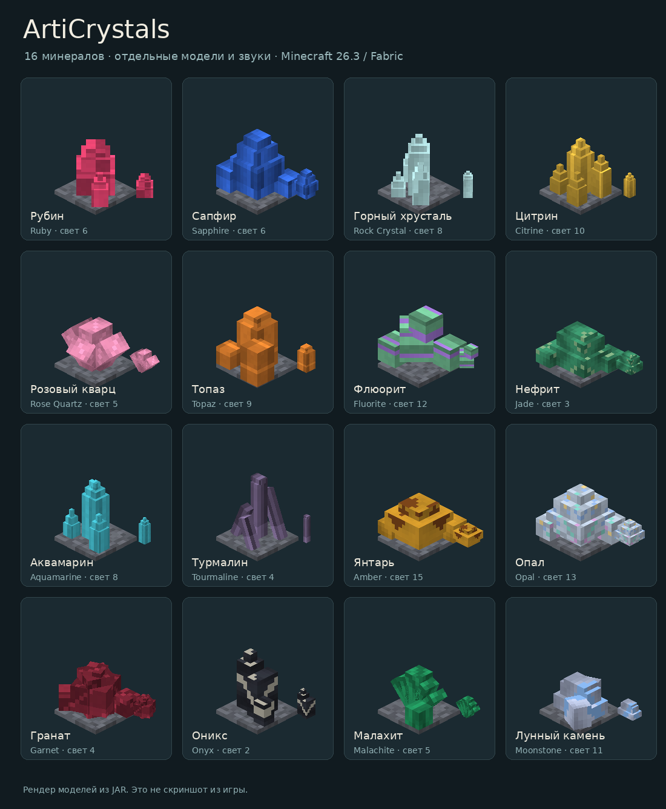
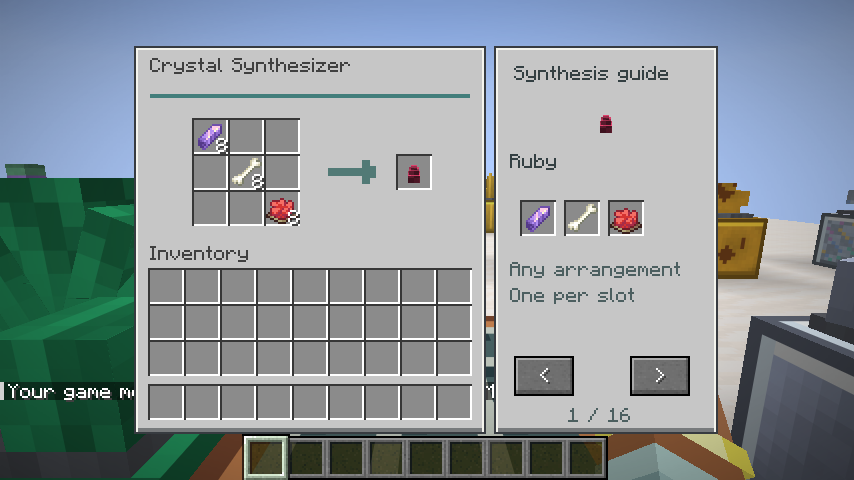
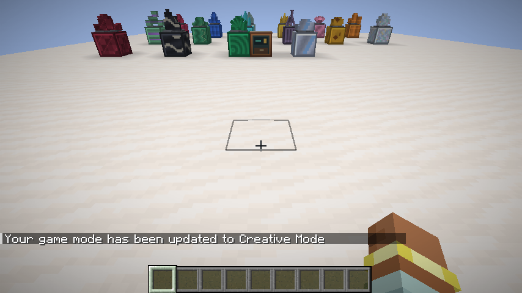

# ArtiCrystals

Fabric-мод для Minecraft Java Edition **26.3** от **Detemkur-Studios**.
Синтез 16 искусственных кристаллов, отдельные объёмные модели, декоративные
кластеры и блоки, линзы, лампы и кристальная подзорная труба.

## Установка

Требуются **Minecraft 26.3**, **Java 25**, **Fabric Loader 0.19.5 или новее**
и **Fabric API 0.163.0 или новее для 26.3**.
Проверен запуск сервера с **0.163.0+26.3 и 0.165.0+26.3**.
Поместите `articrystals-1.0.0+26.3.jar` в папку `mods`.
В одиночной игре достаточно установить его на клиент: встроенный сервер
загружает общую часть автоматически.
На выделенном сервере мод нужен **и серверу, и каждому игроку**.
Архив исходников и файл `-sources.jar` устанавливать в `mods` не нужно.

## Первый публичный релиз 1.0.0

Публичная версия для CurseForge — **1.0.0**, внутренняя версия JAR —
**1.0.0+26.3**. Первый публичный релиз включает 16 минералов, в том числе
гранат, оникс, малахит и лунный камень из первоначальной задумки Claude.
Все ранее созданные минералы сохранены. Требуется Fabric API **0.163.0+**.

При установке оставьте в `mods` только один JAR ArtiCrystals.
Для одиночной игры он нужен на клиенте; для мультиплеера — серверу и игрокам.

Иконка для CurseForge: `docs/articrystals-curseforge-icon.png` (512×512).
Пиксельная иконка рисуется скриптом `python tools/draw_icon.py` на сетке 32×32.
Инструкция по публикации и готовые тексты: `docs/CURSEFORGE.md`.

## Стол синтеза

Сделайте стол в обычном верстаке:

| | | |
|---|---|---|
| Медный слиток | Стекло | Медный слиток |
| Осколок аметиста | Верстак | Осколок аметиста |
| Гладкий камень | Гладкий камень | Гладкий камень |

ПКМ открывает сетку 3×3. Порядок ингредиентов произвольный;
каждый ингредиент занимает отдельный слот. Можно класть стопки:
один синтез расходует по одному предмету из каждого занятого слота.
Результат забирается справа; Shift позволяет синтезировать сразу несколько.
При закрытии оставшиеся ингредиенты возвращаются в инвентарь
(или выпадают рядом, если инвентарь заполнен).
Справа есть справочник всех 16 рецептов. Стрелки листают рецепты;
наведение на иконку показывает название ингредиента.

## Кристаллы

| Кристалл | Ингредиенты в столе синтеза | Свет кластера и блока |
|---|---|---:|
| Рубин | Осколок аметиста + кость + красный краситель | 6 |
| Сапфир | Осколок аметиста + лазурит + синий краситель | 6 |
| Горный хрусталь | Кварц + сахар + стекло + белый краситель | 8 |
| Цитрин | Кварц + светокаменная пыль + жёлтый краситель | 10 |
| Розовый кварц | Кварц + костная мука + розовый краситель | 5 |
| Топаз | Кварц + кусочек золота + оранжевый краситель | 9 |
| Флюорит | Осколок аметиста + слизь + лаймовый краситель | 12 |
| Нефрит | Кварц + глина + зелёный краситель | 3 |
| Аквамарин | Кварц + кристаллы призмарина + голубой краситель | 8 |
| Турмалин | Осколок аметиста + кусочек железа + чёрный краситель | 4 |
| Янтарь | Пчелиные соты + сахар + светокаменная пыль + оранжевый краситель | 15 |
| Опал | Кварц + кристаллы призмарина + осколок аметиста + белый краситель | 13 |
| Гранат | Редстоун + кусочек железа + глина | 4 |
| Оникс | Кварц + уголь + костная мука | 2 |
| Малахит | Необработанная медь + костная мука + зелёный краситель | 5 |
| Лунный камень | Кварц + мембрана фантома + белый краситель | 11 |

Выход каждого рецепта — **1 кристалл**.



У каждого минерала свои геометрия и рисунок текстуры 16×16. Кластеры крепятся
к полу, стенам и потолку, допускают затопление водой и ломаются при потере
опоры. Кластеры выпадают целиком; выращивания и природной генерации в версии
1.0.0 нет. Все кристаллы доступны в выживании через синтез.

## Звуки

У всех 16 минералов отдельные звуковые события: установка, разрушение,
разрушение кластера, удары, шаги, приземление и звон от снаряда.
Используются исходные звуки аметиста Minecraft с разной высотой тона:
оникс и гранат звучат ниже, лунный камень и флюорит — выше.
Лампы используют звуки своего минерала. Звуки не являются новыми записями:
они ссылаются на ванильные события и учитывают замену звуков ресурспаком.
Для каждого события есть русские и английские субтитры.

## Декор и оптика

Все перечисленные ниже рецепты выполняются в **обычном верстаке**.

- **Блок кристалла:** 9 одинаковых кристаллов в квадрате 3×3.
  Один блок можно разобрать обратно в 9 кристаллов.
  Для добычи блока требуется каменная кирка или лучше.
- **Кластер:** 4 одинаковых кристалла буквой Т: один в центре верхнего ряда,
  три во втором ряду; обычный камень в центре нижнего ряда.
- **Прозрачная линза:** горный хрусталь в центре и 4 кусочка меди крестом.
- **Фокусирующая линза:** прозрачная линза + сапфир + аквамарин, порядок любой.
- **Призматическая линза:** прозрачная линза + опал + флюорит, порядок любой.
- **Обычная подзорная труба:** прозрачная линза над двумя медными слитками.
- **Кристальная подзорная труба:** фокусирующая линза над двумя медными
  слитками. Поле зрения вдвое уже, чем у обычной трубы, то есть приближение
  сильнее. Работает стандартное удержание ПКМ и рамка подзорной трубы.
- **Лампа:** рубиновый, сапфировый, розово-кварцевый или нефритовый блок
  + призматическая линза + светокаменная пыль, порядок любой.
  Все четыре лампы дают свет уровня 15. Цветного освещения без шейдеров нет.

В творческом режиме все 57 предметов находятся во вкладке **ArtiCrystals**.
Названия и интерфейс переведены на русский и английский.

## Проверка и скриншоты





Актуальные результаты проверок записаны в [отчёте](docs/TESTING.md).
Снимки сделаны при проверке набора из 16 минералов.

## Сборка из исходников

Установите JDK 25. В корне проекта:

```sh
./gradlew build
```

Windows:

```bat
gradlew.bat build
```

Готовые файлы появятся в `build/libs`. Gradle Wrapper включён в проект;
зависимости Minecraft и Fabric при первой сборке загружаются автоматически.

Текстуры и JSON-модели уже лежат в `src/main/resources`.
Для их повторной генерации нужен Python 3 с Pillow:

```sh
python tools/generate_resources.py
```

Серверные игровые проверки:

```sh
./gradlew runGameTest
```

Клиентский тест с созданием мира и снимками экрана:

```sh
./gradlew runClientGameTest
```

Клиентскому тесту нужен рабочий графический контекст OpenGL или Vulkan.
Тестовый мод из `src/gametest` не попадает в обычный релизный JAR.

## Лицензия и авторство

MIT. Код, пиксельные текстуры и модели этой версии созданы с помощью ChatGPT.
Проект не связан с Mojang или Microsoft.
